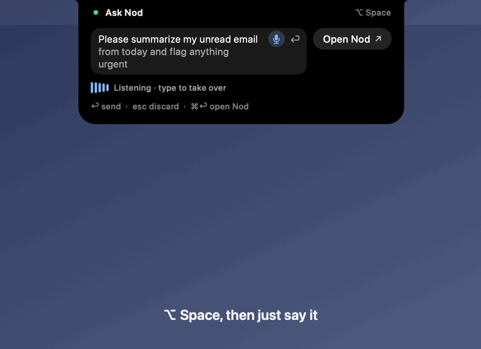
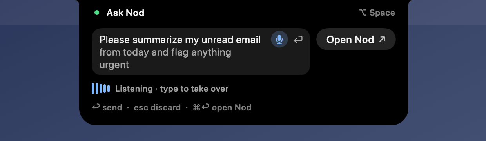
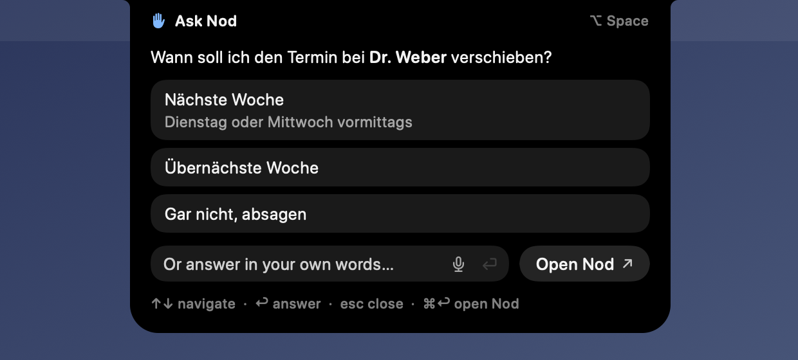
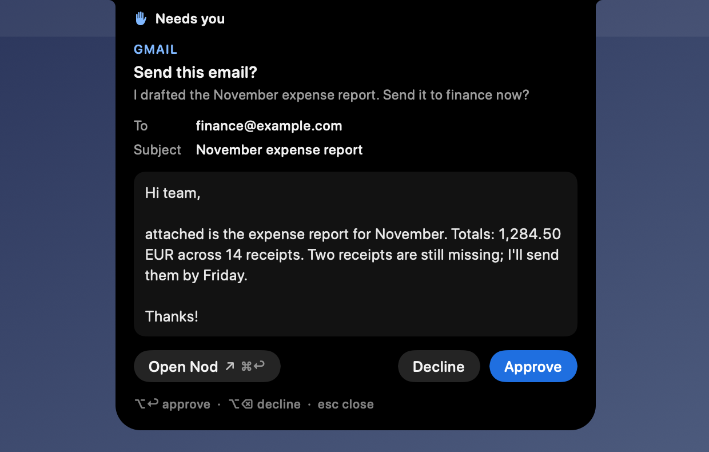
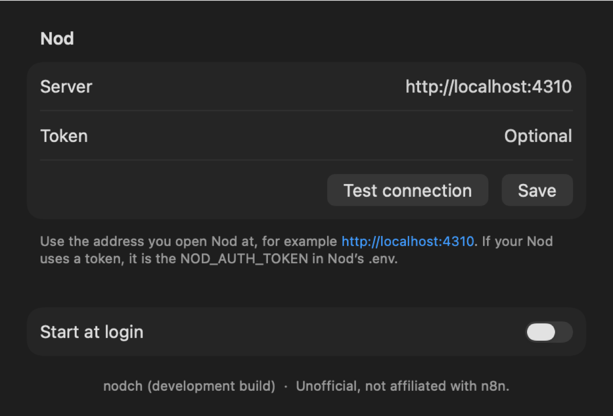

# nodch

**A notch mode for [Nod](https://github.com/n8n-io/nod) on the Mac.** Ask Nod, see what it is doing, answer its
questions and approve what it wants to do, without leaving the app you are in.

**Unofficial.** nodch is an independent project and is not affiliated with or endorsed by n8n.

<p align="center"></p>

nodch lives in the MacBook notch, or at the top of the screen on displays without one, on the display you are
working on. It does a few things and hands everything else to Nod:

- **Ask.** <kbd>⌥ Space</kbd> opens a prompt and starts listening. Speak, and your words appear as you say them; type,
  and the microphone steps aside. Drop files on the island to send them along.
- **Follow.** While Nod works, the island shows the current step and a timer, with a Stop button.
- **Read.** Nod's answer shows in full, with its formatting, and stays above the prompt for ten minutes so you can
  follow up.
- **Answer.** When Nod asks you something, its choices are buttons and the keyboard is already in nodch: pick with
  the arrow keys or type your own answer.
- **Approve.** When Nod wants to act, for example send an email, you see the full action and decide. Nothing is
  approved for you.
- **Go deeper.** <kbd>⌘ Return</kbd> brings the Nod app to the front for the whole conversation.

nodch has no chat of its own. It talks to your running Nod over Nod's HTTP API.

| | |
|---|---|
|  |  |
|  |  |

## Install

You need a Mac with **macOS 26** and a running **Nod** that nodch can reach: Nod run from source, or Nod's
self-host stack (`deployment/self-host`). The Nod desktop app alone keeps its server private, so nodch cannot connect
to it.

1. Download `Nodch-<version>.zip` from the [latest release](https://github.com/tschnorpfeil/nodch/releases/latest),
   unzip it and move **Nodch** to Applications. The app is signed and notarized.
2. Open it. If nodch can't reach Nod at `http://localhost:4310`, its Settings open: enter the address you open Nod at
   and, for the self-host stack, the token (`NOD_AUTH_TOKEN` in Nod's `.env`). **Test connection**, then **Save**.
3. Press <kbd>⌥ Space</kbd>. The first time, macOS asks for the microphone.

Right-click the island for **Settings…**, **Start at login** and **Quit nodch**.

## Keys

| Key | Where | Does |
|---|---|---|
| <kbd>⌥ Space</kbd> | anywhere | Open the prompt; again to hide it (your words stay) |
| <kbd>Return</kbd> | prompt | Send |
| <kbd>Esc</kbd> | prompt | Discard and close |
| <kbd>↑</kbd> <kbd>↓</kbd>, <kbd>Return</kbd> | Nod's question | Move between choices, pick one |
| <kbd>⌥ Return</kbd> | approval / question | Approve, or send the ticked choices |
| <kbd>⌥ ⌫</kbd> | approval | Decline |
| <kbd>⌘ .</kbd> | while Nod works | Stop |
| <kbd>⌘ Return</kbd> | any card | Open the Nod app |
| <kbd>⌘ ,</kbd> / <kbd>⌘ Q</kbd> | any card | Settings / Quit |

Plain <kbd>Return</kbd> never approves. A card that appears by itself ignores clicks and keys for a moment, so a
click meant for another app doesn't decide anything. To change the prompt's shortcut:
`defaults write dev.nodch.Nodch nodch.hotkey "ctrl+option+n"` (or `off`), then restart nodch.

## Dictation

Speech becomes text on your Mac with Apple's on-device speech model, which macOS downloads once, for free. No audio
leaves the Mac. nodch listens in the first of your system languages (System Settings › General › Language & Region)
that the model supports, and falls back to US English. Right-click the microphone to pick another language. The
microphone is on only while the prompt listens; it stops by itself after a pause, and the first key you type stops it
too.

## Privacy

- nodch talks only to the Nod address you set. It has no telemetry and no other servers.
- The token is kept in your login Keychain; the address in nodch's preferences.
- A file you drop is uploaded to your Nod right away, before you press Return.
- See [SECURITY.md](SECURITY.md) for details and how to report a problem.

## Troubleshooting

| You see | Do |
|---|---|
| "Nothing answers at …" | Start Nod, or fix the address in Settings. |
| "doesn't accept this host name" (403) | Use the host from Nod's `NOD_PUBLIC_URL`, usually `localhost`, not `127.0.0.1`. |
| "Nod rejected the token" (401) | Paste `NOD_AUTH_TOKEN` from Nod's `.env` into Settings. |
| <kbd>⌥ Space</kbd> does nothing | Another app may own the shortcut; pick another one (see Keys). |
| "Voice is off: allow nodch…" | Click **Open Settings** next to it and allow nodch under Microphone. |
| "Voice is off: no microphone found." | Connect a microphone, or pick one in System Settings › Sound › Input. |
| "Nod isn’t connected" | Fix what the card says, then **Retry**. |

To uninstall, quit nodch, turn off Start at login and delete the app. To remove its settings too:
`defaults delete dev.nodch.Nodch`, and delete the "nodch: Nod token" item in Keychain Access.

## Build from source

Needs macOS 26 and the Swift 6 command-line tools; Xcode is not needed.

```sh
swift build --package-path app
swift run --package-path app NodchChecks   # the checks; must exit 0
scripts/bundle.sh                          # build/Nodch.app, ad-hoc signed
open build/Nodch.app
```

Environment variables override Settings, which is handy for scripts and LaunchAgents:

```sh
NOD_URL=http://localhost:4310 NOD_AUTH_TOKEN=<token> swift run --package-path app Nodch
```

`NOD_DATA_ROOT=<nod>/.local` reads the access key of a Nod run from source instead of a token.

Without a Nod at hand:

```sh
swift run --package-path app Nodch --demo              # cycles through every state
swift run --package-path app Nodch --snapshot <dir>    # renders every state to PNG
swift run --package-path app Nodch --transcribe <file> # the prompt's speech-to-text on an audio file
scripts/contract.sh                                    # a real Nod with a free stub model (Node 24, Docker)
```

See [docs/contract.md](docs/contract.md) for the contract test, [CONTRIBUTING.md](CONTRIBUTING.md) before a pull
request, and `scripts/release.sh` for a signed, notarized build.

## License

Apache-2.0, see [LICENSE](LICENSE) and [NOTICE](NOTICE). Parts are adapted from
[Pippa](https://github.com/tschnorpfeil/pippa) (MIT).
